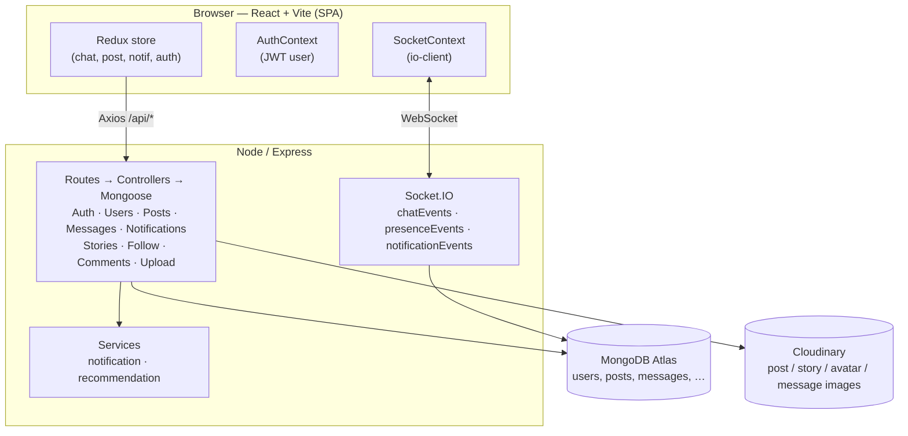
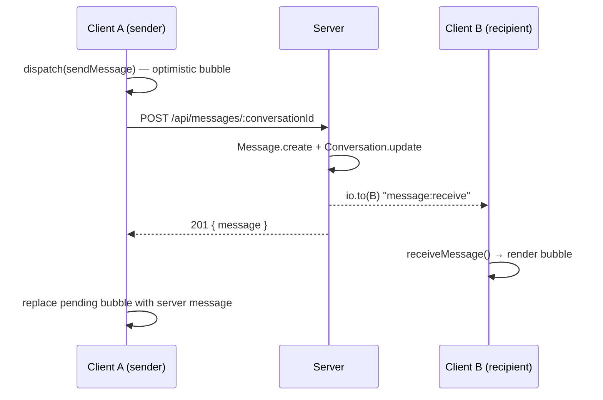

><div align="center">

# Rivvo

**Connect. Share. Live.**

A bilingual social network built with the MERN stack. It has real-time chat, stories, an explore feed, notifications, and a full follower system.

[](#tech-stack)
[](#tech-stack)
[](#tech-stack)
[](#tech-stack)
[](#internationalization)
[](#license)

</div>

---

## Overview

Rivvo is a social networking app that works in both **English** and **العربية**, including full right-to-left layout. The project is a monorepo with two parts: a **React + Vite** frontend and a **Node/Express + Socket.IO** backend. You can deploy the frontend to Vercel and the backend to any Node host.

## Table of Contents

1. [Features](#features)
2. [Tech Stack](#tech-stack)
3. [Architecture](#architecture)
4. [Project Structure](#project-structure)
5. [Getting Started](#getting-started)
6. [Environment Variables](#environment-variables)
7. [API Reference](#api-reference)
8. [Socket.IO Events](#socketio-events)
9. [Database Models](#database-models)
10. [Internationalization](#internationalization)
11. [Theme System](#theme-system)
12. [Deployment](#deployment)
13. [Scripts](#scripts)
14. [Troubleshooting](#troubleshooting)
15. [Contributing](#contributing)
16. [License](#license)
17. [Acknowledgements](#acknowledgements)

---

## Features

### Authentication
- Email / password registration and login with JWT
- Secure password hashing with **bcryptjs** (cost factor 10)
- Forgot / reset password flow via SMTP (Nodemailer)
- Token-based session persistence (`localStorage` + `Bearer` header)
- Rate-limited auth endpoints (100 requests / 15 minutes)

### Posts and Feed
- Create text and image posts (up to 10 MB per image, Cloudinary-hosted)
- Home feed with **For You** (all posts) and **Following** tabs
- Inline caption editing for the post owner
- Delete with confirmation (cascades to comments)
- Like, save, and share (native share sheet with clipboard fallback)
- Comments with live per-post updates
- Caption tokenizer: `#hashtags` link to Explore, `@mentions` link to profiles

### Explore
- Full-text search across people and posts
- Hashtag pages (`/explore?tag=vibes`)
- **Popular** / **Latest** sorting (popularity = likes + 2 × comments)
- Trending hashtags extracted from the last 7 days
- Recent searches persisted in `localStorage`
- Infinite-scrolling grid with skeleton loading

### Stories
- 24-hour ephemeral stories (auto-expire via `expiresAt`)
- Cloudinary uploads with progress state
- Instagram-style viewer with progress bars and auto-advance
- View tracking (`viewers[]`) drives the "viewed" ring state

### Real-time Messaging
- 1:1 conversations with live Socket.IO delivery
- Optimistic message bubbles (pending → sent → seen)
- Image attachments (Cloudinary) with thumbnails
- Typing indicators and read receipts (double-tick)
- Soft-delete (`deleted` flag, no data loss)
- Pagination with scroll anchoring (no jump when loading older messages)
- Presence (online / offline / last seen)
- Unread badges in the navbar, sidebar, mobile nav, and conversation list

### Notifications
- Like, comment, follow, and message notifications
- Real-time delivery over Socket.IO
- Unread count badge with `99+` cap
- Mark-as-read on click

### Social Graph
- Follow / unfollow with instant optimistic UI
- Followers / Following lists in a modal
- "Who to follow" suggestions (sorted by follower count)
- Public profiles with posts grid, stats, and counts

### Internationalization
- English (LTR) and Arabic (RTL)
- Full translation coverage — frontend dictionary + backend `Accept-Language`
- Logical CSS properties (`inset-inline-end`, `margin-inline-start`) so layouts mirror correctly
- Localized dates (`Intl.RelativeTimeFormat`) and numbers (`Intl.NumberFormat` with `notation: 'compact'`)

### Theming
- Dark-first design with a light theme toggle
- CSS variables for all design tokens
- Persisted choice in `localStorage` (`rivvo_theme`)

---

## Tech Stack

### Frontend

| Layer | Choice |
|---|---|
| Framework | React 18 |
| Build tool | Vite 5 |
| Routing | React Router v6 |
| State | Redux Toolkit + React-Redux |
| HTTP | Axios (interceptors for auth + language) |
| Realtime | socket.io-client |
| Icons | react-icons/io5 |
| Fonts | Poppins (EN), Tajawal (AR) |

### Backend

| Layer | Choice |
|---|---|
| Runtime | Node.js 18+ |
| Framework | Express 4 |
| Database | MongoDB + Mongoose 8 |
| Realtime | Socket.IO 4 |
| Auth | JWT (`jsonwebtoken`) + bcryptjs |
| Uploads | Multer (memory storage) → Cloudinary streaming |
| Email | Nodemailer (SMTP) |
| Security | Helmet, CORS, express-rate-limit |
| Logging | Morgan, custom logger |

### Infrastructure

| Concern | Recommended |
|---|---|
| Frontend host | Vercel (static Vite build) |
| Backend host | Any Node 18+ host (Railway, Fly.io, Render, VPS) |
| Database | MongoDB Atlas |
| Media | Cloudinary |
| Email | Any SMTP provider (SendGrid, Mailgun, Gmail app password…) |

---

## Architecture



**Typical write request**

1. The client dispatches a Redux thunk → Axios `POST /api/...`
2. Express route → `protect` middleware verifies the JWT → controller
3. The controller mutates MongoDB and emits `notification:new` / `message:receive` over Socket.IO
4. All connected participants receive the event and their slices update

**Real-time chat flow**



---

## Project Structure

```text
rivvo/
├── client/                         # Vite + React frontend
│   ├── public/
│   │   └── favicon.svg
│   ├── src/
│   │   ├── components/
│   │   │   ├── chat/               # ChatList, ChatWindow, Message, MessageButton,
│   │   │   │                       # MessageInput, NewMessageModal, TypingIndicator
│   │   │   ├── common/             # Avatar, Button, ConfirmModal, LanguageSwitcher,
│   │   │   │                       # Modal, Skeleton, Spinner
│   │   │   ├── explore/            # ExploreGrid, ExploreTile, PeopleResults,
│   │   │   │                       # RecentSearches, TrendingTags
│   │   │   ├── layout/             # AppLayout, MobileNav, Navbar,
│   │   │   │                       # RealtimeListener, Sidebar
│   │   │   ├── notifications/      # NotificationItem, NotificationList
│   │   │   ├── post/               # Caption, CommentSection, CreatePost, PostActions,
│   │   │   │                       # PostCard, PostEditor, PostHeader, PostList, PostMenu
│   │   │   ├── profile/            # FollowButton, FollowList, ProfileHeader,
│   │   │   │                       # ProfilePosts, ProfileStats, UserRow, WhoToFollow
│   │   │   └── story/              # StoryBar, StoryCard, StoryViewer
│   │   ├── context/                # AuthContext, LanguageContext,
│   │   │                           # SocketContext, ThemeContext
│   │   ├── hooks/                  # useAuth, useDebounce, useInfiniteScroll, useSocket
│   │   ├── i18n/
│   │   │   └── translations.js     # EN + AR dictionaries + LANGUAGES meta
│   │   ├── pages/
│   │   │   ├── auth/               # ForgotPassword, Login, Register, ResetPassword
│   │   │   ├── Explore.jsx
│   │   │   ├── Home.jsx
│   │   │   ├── Messages.jsx
│   │   │   ├── NotFound.jsx
│   │   │   ├── Notifications.jsx
│   │   │   ├── PostPage.jsx
│   │   │   ├── Profile.jsx
│   │   │   ├── Saved.jsx
│   │   │   └── Settings.jsx
│   │   ├── routes/
│   │   │   └── AppRoutes.jsx
│   │   ├── services/
│   │   │   ├── api.js              # Axios instance + interceptors
│   │   │   └── …                   # auth, message, notification, post, story,
│   │   │                           # upload, user services
│   │   ├── store/                  # authSlice, chatSlice, notificationSlice,
│   │   │                           # postSlice, index
│   │   ├── utils/                  # caption, chat, constants, errorMessage,
│   │   │                           # exploreQuery, formatDate, formatNumber,
│   │   │                           # formatTime, recentSearches, share, validators
│   │   ├── App.jsx
│   │   ├── index.css
│   │   └── main.jsx
│   ├── index.html
│   ├── package.json
│   └── vite.config.js
│
├── server/                         # Express + Socket.IO backend
│   ├── config/                     # cloudinary, database, environment, mail
│   ├── controllers/                # auth, comment, follow, message, notification,
│   │                               # post, story, upload, user
│   ├── i18n/
│   │   └── messages.js             # EN + AR backend strings
│   ├── middleware/                 # auth, error, lang, rateLimit, upload
│   ├── models/                     # Comment, Conversation, Follow, Message,
│   │                               # Notification, Post, Story, User
│   ├── routes/                     # one route file per controller
│   ├── scripts/
│   │   └── check-cloudinary.js
│   ├── services/                   # notificationService, recommendationService
│   ├── socket/                     # chatEvents, notificationEvents,
│   │                               # presenceEvents, socketServer
│   ├── utils/                      # generateToken, logger, pagination, validation
│   ├── app.js
│   ├── package.json
│   └── server.js
│
└── README.md
```

---

## Getting Started

### Prerequisites

| Requirement | Version |
|---|---|
| Node.js | ≥ 18 (LTS recommended) |
| npm | ≥ 9 |
| MongoDB | Local ≥ 6, or a MongoDB Atlas account |
| Cloudinary | Free tier is sufficient |
| SMTP account | Any provider (SendGrid, Mailgun, Gmail app password) |

### Installation

```bash
# 1. Clone
git clone https://github.com/<your-org>/rivvo.git
cd rivvo

# 2. Install the server
cd server
npm install
cp .env.example .env        # then edit .env (see Environment Variables)

# 3. Install the client (new terminal)
cd ../client
npm install
cp .env.example .env        # optional in dev — defaults hit the Vite proxy
```

### Run in development

```bash
# Terminal A — API server
cd server && npm run dev    # → http://localhost:5000

# Terminal B — web client
cd client && npm run dev    # → http://localhost:5173
```

The Vite dev server proxies `/api` to `http://localhost:5000` (see `vite.config.js`), so no client-side `VITE_API_URL` is needed during development.

### First run

1. Open <http://localhost:5173>
2. Register an account (username rules: `^[a-zA-Z0-9_.]{3,20}$`, password ≥ 8 characters)
3. Optionally register a second account in a private window to test messaging, follows, and notifications in real time

---

## Environment Variables

### `server/.env`

```env
# ── core ─────────────────────────────────────────────────────────────
PORT=5000
NODE_ENV=development
CLIENT_URL=http://localhost:5173

# ── database ─────────────────────────────────────────────────────────
MONGO_URI=mongodb+srv://<user>:<pass>@cluster0.xxxxx.mongodb.net/rivvo

# ── auth ─────────────────────────────────────────────────────────────
JWT_SECRET=change-me-to-a-long-random-string
JWT_EXPIRE=7d

# ── cloudinary ───────────────────────────────────────────────────────
CLOUDINARY_CLOUD_NAME=your-cloud-name
CLOUDINARY_API_KEY=123456789012345
CLOUDINARY_API_SECRET=abcdef1234567890abcdef1234567890

# ── smtp ─────────────────────────────────────────────────────────────
SMTP_HOST=smtp.example.com
SMTP_PORT=587
SMTP_USER=apikey
SMTP_PASS=your-smtp-password
EMAIL_FROM=Rivvo <no-reply@rivvo.app>
```

| Variable | Required | Description |
|---|:---:|---|
| `PORT` | ✓ | HTTP port (default `5000`) |
| `NODE_ENV` | — | `development` exposes error details in responses |
| `CLIENT_URL` | ✓ | CORS origin — must match the frontend URL exactly (no trailing slash) |
| `MONGO_URI` | ✓ | MongoDB connection string |
| `JWT_SECRET` | ✓ | Signing key for access tokens — use ≥ 32 random bytes |
| `JWT_EXPIRE` | — | Token lifetime (`7d` default) |
| `CLOUDINARY_*` | ✓ | Cloudinary credentials — needed for every image upload |
| `SMTP_*` | ✓ | Used for password-reset emails only |
| `EMAIL_FROM` | — | `From` header for outbound email |

> **Heads up:** never commit your `.env` files. Keep real secrets out of version control, and rotate any credential that has ever been exposed.

### `client/.env` (production only)

```env
VITE_API_URL=https://api.rivvo.app/api
VITE_SOCKET_URL=https://api.rivvo.app
```

| Variable | Required | Description |
|---|:---:|---|
| `VITE_API_URL` | Production | Backend base URL **including** `/api`. Omitted in dev (the proxy handles it) |
| `VITE_SOCKET_URL` | Production | Socket.IO origin — **without** `/api` |

---

## API Reference

All endpoints are prefixed with `/api`. Unless marked **public**, they require:

```http
Authorization: Bearer <jwt>
Accept-Language: en | ar        # optional — affects error messages
```

Responses are JSON. Errors use `{ "message": "...", "detail"?: "..." }`.

### Auth — `/api/auth`

| Method | Path | Auth | Body | Returns |
|---|---|:---:|---|---|
| POST | `/register` | public | `{ username, email, password }` | `{ token, user }` |
| POST | `/login` | public | `{ email, password }` | `{ token, user }` |
| POST | `/logout` | ✓ | — | `{ message }` |
| POST | `/forgot-password` | public | `{ email }` | `{ message }` |
| POST | `/reset-password/:token` | public | `{ password }` | `{ message, token }` |

### Users — `/api/users`

| Method | Path | Auth | Body / Query | Returns |
|---|---|:---:|---|---|
| GET | `/search?q=` | ✓ | — | `User[]` (max 20) |
| GET | `/suggestions` | ✓ | — | `User[]` (excludes self + followed) |
| PUT | `/me` | ✓ | `{ fullName?, bio?, avatar? }` | `User` |
| GET | `/:username/connections?type=followers\|following` | ✓ | — | `User[]` with `isFollowing` |
| GET | `/:username` | ✓ | — | `{ ...User, posts, postCount, isFollowing }` |

### Posts — `/api/posts`

| Method | Path | Auth | Body / Query | Returns |
|---|---|:---:|---|---|
| GET | `/?page=` | ✓ | — | `Post[]` (10/page, hydrated with `isSaved`) |
| POST | `/` | ✓ | `{ caption?, images?: string[] }` | `Post` |
| GET | `/explore?q=&tag=&sort=popular\|latest&page=` | ✓ | — | `Post[]` (12/page) |
| GET | `/tags/trending` | ✓ | — | `{ tag, count }[]` (top 10 of last 7 days) |
| GET | `/saved?page=` | ✓ | — | `Post[]` (`isSaved: true`) |
| GET | `/:id` | ✓ | — | `Post` |
| PUT | `/:id` | ✓ | `{ caption }` | `Post` (owner only) |
| DELETE | `/:id` | ✓ | — | `{ message }` (owner only) |
| POST | `/:id/like` | ✓ | — | `{ likes: ObjectId[] }` |
| DELETE | `/:id/like` | ✓ | — | `{ likes: ObjectId[] }` |
| POST | `/:id/save` | ✓ | — | `{ saved: true }` |
| DELETE | `/:id/save` | ✓ | — | `{ saved: false }` |
| POST | `/:id/comments` | ✓ | `{ text }` | `Comment` |
| GET | `/:id/comments` | ✓ | — | `Comment[]` |

### Comments — `/api/comments`

| Method | Path | Auth | Body | Returns |
|---|---|:---:|---|---|
| GET | `/` | ✓ | — | `Comment[]` |
| GET | `/:id` | ✓ | — | `Comment` |
| POST | `/` | ✓ | `{ post, text }` | `Comment` |
| PUT | `/:id` | ✓ | `{ text }` | `Comment` |
| DELETE | `/:id` | ✓ | — | `{ message }` |

### Stories — `/api/stories`

| Method | Path | Auth | Body | Returns |
|---|---|:---:|---|---|
| GET | `/` | ✓ | — | `Story[]` with `viewed` flag (non-expired only) |
| POST | `/` | ✓ | `{ media }` | `Story` |
| POST | `/:id/view` | ✓ | — | `{ message }` |

### Follow — `/api/follow`

| Method | Path | Auth | Returns |
|---|---|:---:|---|
| POST | `/:id` | ✓ | `{ following: true, followersCount }` |
| DELETE | `/:id` | ✓ | `{ following: false, followersCount }` |

### Messages — `/api/messages`

| Method | Path | Auth | Body / Query | Returns |
|---|---|:---:|---|---|
| GET | `/conversations` | ✓ | — | `Conversation[]` with `unreadCount` |
| POST | `/conversations` | ✓ | `{ userId }` | `Conversation` (created if missing) |
| GET | `/:conversationId?before=&limit=` | ✓ | — | `{ messages, hasMore }` (oldest first) |
| POST | `/:conversationId` | ✓ | `{ text?, attachment? }` | `Message` |
| PUT | `/:conversationId/read` | ✓ | — | `{ conversationId }` |
| DELETE | `/item/:messageId` | ✓ | — | `{ id, conversationId }` (soft-delete) |

### Notifications — `/api/notifications`

| Method | Path | Auth | Returns |
|---|---|:---:|---|
| GET | `/` | ✓ | `Notification[]` (sender populated) |
| PUT | `/:id/read` | ✓ | `{ message }` |

### Upload — `/api/upload`

| Method | Path | Auth | Body (multipart) | Returns |
|---|---|:---:|---|---|
| POST | `/` | ✓ | `image`, `folder` | `{ url, publicId }` |

- **Allowed folders:** `rivvo/posts`, `rivvo/stories`, `rivvo/avatars`, `rivvo/messages`
- **Limits:** ≤ 10 MB, `image/*` MIME types only

### Health

| Method | Path | Returns |
|---|---|---|
| GET | `/api/health` | `{ status: 'ok' }` |

---

## Socket.IO Events

The client authenticates via `socket.handshake.auth.token`. On connect, the socket joins the room `user:<userId>`.

### Client → Server

| Event | Payload | Effect |
|---|---|---|
| `message:send` | `{ conversationId, text, attachment }` | Persist message + broadcast to participants (optional — the REST path also works) |
| `typing:start` | `{ conversationId }` | Broadcast `typing:start` to the other participant |
| `typing:stop` | `{ conversationId }` | Broadcast `typing:stop` |
| `notification:read` | `{ notificationId }` | Echo mark-read to self |

### Server → Client

| Event | Payload | When |
|---|---|---|
| `message:receive` | `Message` | New message in any of my conversations |
| `message:read` | `{ conversationId, userId }` | The other side read my messages |
| `message:deleted` | `{ conversationId, messageId }` | A message was soft-deleted |
| `typing:start` / `typing:stop` | `{ conversationId, userId }` | The other user starts / stops typing |
| `notification:new` | `Notification` (sender populated) | I received a like / comment / follow / message notification |
| `presence:init` | `{ userIds: string[] }` | On connect — full online roster |
| `user:online` / `user:offline` | `{ userId }` | Another user connects / disconnects |

---

## Database Models

### User

```js
{
  username: String,             // unique, trimmed, 3–20 chars
  email: String,                // unique, lowercase
  password: String,             // bcrypt hash, select: false
  fullName: String,
  avatar: String,               // Cloudinary URL
  bio: String,                  // max 150 chars
  followers: [ObjectId → User],
  following: [ObjectId → User],
  isOnline: Boolean,
  lastSeen: Date,
  resetPasswordToken: String,   // select: false
  resetPasswordExpire: Date,    // select: false
  timestamps: true,
}
```

### Post

```js
{
  user: ObjectId → User,
  caption: String,
  images: [String],
  likes: [ObjectId → User],
  comments: [ObjectId → Comment],
  savedBy: [ObjectId → User],   // drives the saved-posts feed
  timestamps: true,
}
```

### Comment

```js
{
  post: ObjectId → Post,
  user: ObjectId → User,
  text: String,
  likes: [ObjectId → User],
  timestamps: true,
}
```

### Story

```js
{
  user: ObjectId → User,
  media: String,
  viewers: [ObjectId → User],
  expiresAt: Date,              // default: now + 24h
  timestamps: true,
}
```

### Conversation

```js
{
  participants: [ObjectId → User],   // exactly 2 for 1:1
  lastMessage: ObjectId → Message,
  timestamps: true,
}
```

### Message

```js
{
  conversation: ObjectId → Conversation,
  sender: ObjectId → User,
  text: String,
  attachment: String,                // Cloudinary URL
  readBy: [ObjectId → User],
  deleted: Boolean,                  // soft delete
  timestamps: true,
}
```

### Notification

```js
{
  recipient: ObjectId → User,
  sender: ObjectId → User,
  type: 'like' | 'comment' | 'follow' | 'message',
  post: ObjectId → Post,             // optional (null for follow / message)
  read: Boolean,
  timestamps: true,
}
```

### Follow

> **Legacy model.** `followController` uses `$addToSet` on `User.followers` / `User.following` instead. The model is retained for schema compatibility.

---

## Internationalization

Two locales are supported: `en` (LTR) and `ar` (RTL).

### Frontend

`LanguageProvider` reads `rivvo_lang` from `localStorage`, falling back to `navigator.language`. On change it updates:

```js
document.documentElement.lang = lang;
document.documentElement.dir  = LANGUAGES[lang].dir;
document.title = `Rivvo — ${translations[lang].tagline}`;
```

Translation lookup uses `t('key', { name: 'x' })`, falling back to English, then to the key itself.

### Backend

`langMiddleware` reads `Accept-Language` and attaches `req.lang` and `req.t(key, vars)` to each request, so controllers can return localized error strings. The Axios interceptor sets `Accept-Language` from `localStorage`.

### RTL correctness

All directional CSS uses logical properties (`inset-inline-end`, `border-inline-end`, `margin-inline-start`, `border-start-start-radius`, etc.). Adding a third RTL locale only requires a new `translations.js` entry — no CSS changes.

---

## Theme System

`ThemeProvider` writes `data-theme` to `<html>` and persists `rivvo_theme` in `localStorage`. Two palettes are defined in `index.css`:

| Token | Dark | Light |
|---|---|---|
| `--bg` | `#0B1020` | `#F4F6FB` |
| `--surface` | `#131A2E` | `#FFFFFF` |
| `--surface-2` | `#1B2440` | `#EEF1F8` |
| `--border` | `rgba(255,255,255,0.09)` | `rgba(15,23,42,0.1)` |
| `--text` | `#F1F5F9` | `#0F172A` |
| `--text-muted` | `#94A3B8` | `#64748B` |

**Brand gradient:** `linear-gradient(90deg, #6366F1, #EC4899)` — used on the send button, unread badges, active tab pills, and the Rivvo wordmark.

---

## Deployment

### Frontend → Vercel

1. Import the repo into Vercel and set **Root Directory** to `client`
2. Framework preset: **Vite**
3. Build command: `npm run build`
4. Output directory: `dist`
5. Environment variables:

   ```text
   VITE_API_URL=https://api.your-domain.com/api
   VITE_SOCKET_URL=https://api.your-domain.com
   ```

6. Deploy

> **Important:** every package the client imports (`react-icons`, `socket.io-client`, and so on) has to be listed in `client/package.json` and committed along with `package-lock.json`. Vercel runs `npm ci` against the lockfile, so anything you installed locally without `--save` won't make it into the build.

### Backend → Railway / Render / Fly.io / VPS

1. Root directory: `server`
2. Start command: `npm start` (runs `node server.js`)
3. Node version: 18+
4. Environment variables: everything from `server/.env` above, plus:

   ```text
   NODE_ENV=production
   CLIENT_URL=https://your-vercel-app.vercel.app
   ```

The server allows CORS from `CLIENT_URL` — already wired in `app.js` and `socketServer.js`.

### Database → MongoDB Atlas

1. Create a free cluster
2. Create a database user with read/write access on `rivvo`
3. Network Access: allow `0.0.0.0/0` (or your backend host's IPs)
4. Copy the connection string into `MONGO_URI`

### Media → Cloudinary

1. Sign up and copy the **Cloud Name**, **API Key**, and **API Secret** from the dashboard
2. Paste them into `server/.env`
3. Restart the Node server — `.env` is only read at boot
4. Verify with `npm run check:cloudinary`

---

## Scripts

### `server/package.json`

| Command | Purpose |
|---|---|
| `npm run dev` | `nodemon server.js` — auto-restart on change |
| `npm start` | `node server.js` — production |
| `npm run check:cloudinary` | Diagnostic — validates Cloudinary credentials with three real probes |

### `client/package.json`

| Command | Purpose |
|---|---|
| `npm run dev` | Vite dev server with HMR on `:5173` |
| `npm run build` | Production bundle → `dist/` |
| `npm run preview` | Serve the built bundle locally |

---

## Troubleshooting

### Uploads fail with `502 Bad Gateway`

This means your server reached Cloudinary, but Cloudinary turned the upload down. The HTTP status is masked, so to find the real reason, check the `detail` field in the response body or the server console (`[upload] Cloudinary error: ...`).

Start with the built-in diagnostic:

```bash
cd server
npm run check:cloudinary
```

Then match what it prints to one of these fixes:

| Output | Fix |
|---|---|
| `http 401` / `Invalid Signature` | `CLOUDINARY_API_SECRET` is wrong — re-copy it from the dashboard (watch for trailing spaces) and restart the server |
| `http 403` / `Untrusted` | Verify your email / phone in the Cloudinary dashboard |
| `quota` / `limit` | Free tier exhausted — check the Usage page |
| `network error` / `timeout` | A firewall, antivirus, or ISP is blocking `api.cloudinary.com` — try a VPN or hotspot |

### Image messages send but `attachment` is empty

Older versions of `messageController.js` didn't save the `attachment` field. You can check in `mongosh`:

```js
db.messages.find().sort({ createdAt: -1 }).limit(1)
```

If `attachment` is an empty string after you send an image, add the attachment save back into `sendMessage`.

### Messaging: `messages is not iterable`

The frontend `fetchMessages` thunk expects `{ messages, hasMore }`, but older backends returned a bare array. Change `getMessages` so it returns the paginated shape.

### `Router.use() requires a middleware function but got a Object`

One of your route files is missing `module.exports = router;` at the end. This command will point you to it:

```bash
cd server
grep -rL "module.exports = router" routes/
```

### Vercel build: `failed to resolve import "react-icons/io5"`

`react-icons` isn't listed in `client/package.json`. Add it, run `npm install`, commit both `package.json` and `package-lock.json`, and redeploy.

### Notification bell never shows a count

The count stays at `0` until someone opens the notifications page. Make sure `fetchNotifications()` is dispatched at the app level (in `RealtimeListener`), not only from `NotificationList`. Also dispatch `resetNotifications()` on logout so the next user doesn't see the previous user's count.

### `GET /api/posts/explore` returns 500

Express is reading `"explore"` as a Mongo ObjectId because the literal route is registered after `/:id`. Reorder `postRoutes.js` so all literal paths come first and `/:id` comes last.

### `PUT /api/messages/:id/read` returns 404

That route hasn't been declared yet. Add this to `messageRoutes.js`:

```js
router.put('/:conversationId/read', protect, markRead);
```

### Chat UI renders unstyled

`index.css` is probably still targeting old class names (`.chat-list li`, `.message-input input`) that no longer match the JSX (`.chat-item`, `.message-input textarea`). Replace the Chat section of `index.css` with the updated styles, and delete the old block completely. The old selector `.chat-window > header` (specificity 0,1,1) outranks `.chat-header` (0,1,0), so any leftovers will quietly override your new styles.

### Password reset emails aren't arriving

- Check SMTP credentials with any mailbox tool, e.g. `swaks --to you@example.com --server smtp.example.com:587 --auth LOGIN`
- Gmail requires an **app password** (2FA must be enabled), not the account password
- Many providers block port 25 — use `587` (STARTTLS) or `465` (SSL)

### CORS errors on the deployed backend

`CLIENT_URL` must exactly match the frontend origin — scheme + host + port, **no trailing slash**. `https://rivvo.vercel.app/` ≠ `https://rivvo.vercel.app`.

---

## Contributing

Contributions are welcome, whether it's a bug fix, a translation, or a new feature.

1. Fork the repo
2. Create a feature branch: `git checkout -b feat/your-feature`
3. Please follow the existing patterns:
   - **Frontend** — keep components pure; state goes in Redux slices or context
   - **Backend** — controllers only orchestrate; services hold business logic
   - **Errors** — always `next(err)`; the central handler localizes them
4. Add or update translations in both `client/src/i18n/translations.js` and `server/i18n/messages.js`
5. If you touch CSS, use logical properties — test with `dir="rtl"` on `<html>`
6. Open a pull request against `main`

### Code style

- ES modules on the client (`import` / `export`), CommonJS on the server (`require` / `module.exports`)
- Prefer `async` / `await` over promise chains in application code
- No `console.log` in committed code — use the `logger` utility
- The codebase is plain JavaScript; keep types in JSDoc where helpful

---

## License

MIT © Rivvo contributors — see [LICENSE](LICENSE) for details.

## Acknowledgements

- Icons: [Ionicons](https://ionic.io/ionicons) via `react-icons`
- Fonts: Poppins & Tajawal — [Google Fonts](https://fonts.google.com)
- Media hosting: [Cloudinary](https://cloudinary.com)
- Database: [MongoDB Atlas](https://www.mongodb.com/atlas)
